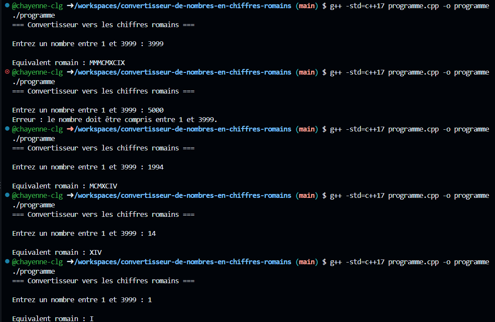

# Convertisseur de nombres en chiffres romains

## Description

Programme développé en C++ permettant de convertir un nombre entier compris entre 1 et 3999 en chiffres romains.

## Fonctionnement

L'utilisateur choisi un nombre et le programme génére l'écriture correspondante.

## Exemples

   

## Concepts utilisés

- Fonctions
- Tableaux
- Boucles
- Conditions
- Chaines de caractères

## Objectif du projet

- Comprendre les algorithmes de conversion
- Manipuler les tableaux en C++
- Travailler sur la décomposition d'un problème
 
  ## Auteur

  Chayenne Le Gall
